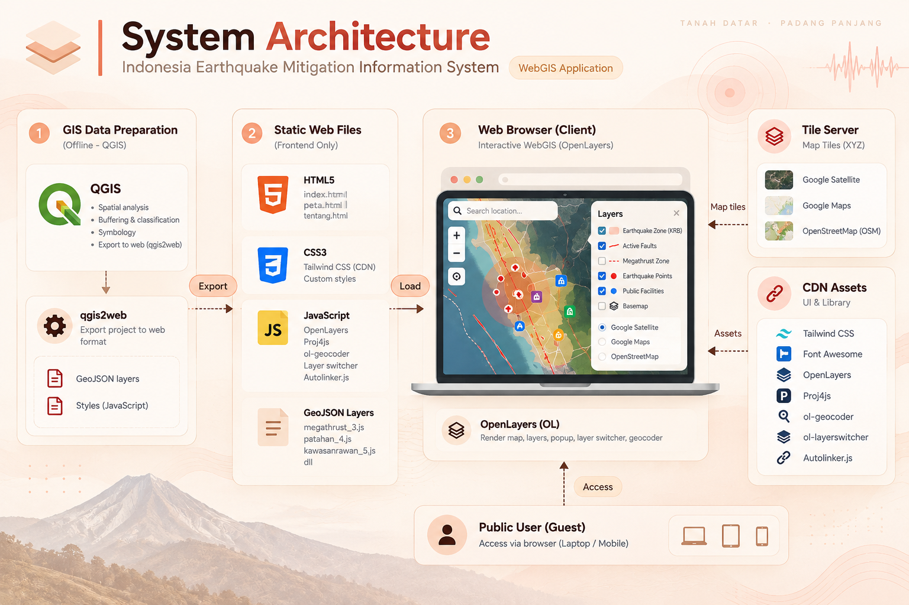
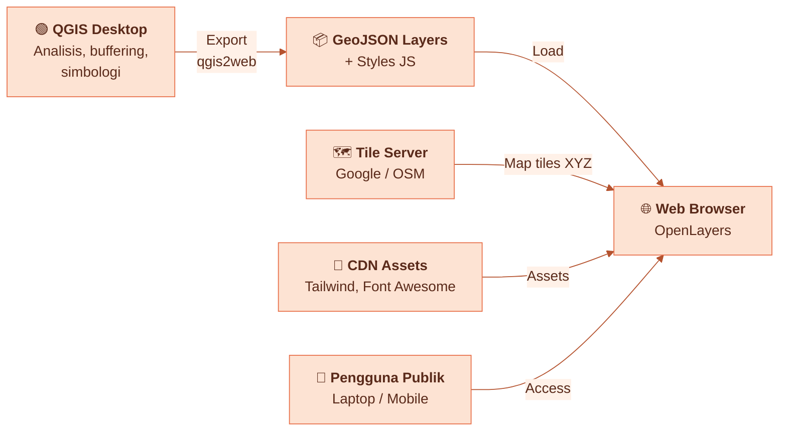

<!-- ═══════════════ HEADER ═══════════════ -->
<div align="center">



<br/><br/>

<p>
  <b>WebGIS interaktif</b> untuk visualisasi risiko gempa bumi dan kesiapsiagaan bencana<br/>
  di <b>Kabupaten Tanah Datar</b> &amp; <b>Kota Padang Panjang</b>, Sumatera Barat.
</p>

<p>
  
  
  
  
</p>

<p>
  <a href="#-tentang-proyek">Tentang</a> •
  <a href="#-fitur-utama">Fitur</a> •
  <a href="#️-arsitektur-sistem">Arsitektur</a> •
  <a href="#️-teknologi">Teknologi</a> •
  <a href="#-instalasi--menjalankan">Instalasi</a> •
  <a href="#️-batasan-sistem">Batasan</a> •
  <a href="#-tim-pengembang">Tim</a>
</p>

</div>

<br/>

<!-- ═══════════════ PREVIEW ═══════════════ -->
<div align="center">
  
  <br/>
  <sub><i>Tampilan halaman peta interaktif</i></sub>
</div>

---

## 🌋 Tentang Proyek

**Sistem Informasi Mitigasi Gempa Indonesia** adalah aplikasi **WebGIS** yang memetakan tingkat kerentanan gempa bumi, struktur tektonik, serta fasilitas publik dan evakuasi di Kabupaten Tanah Datar dan Kota Padang Panjang. Data diolah dengan **QGIS**, diekspor menggunakan **qgis2web**, lalu ditampilkan di browser melalui **OpenLayers** tanpa server backend maupun database.

> 🎯 **Tujuan:** membantu masyarakat dan pemangku kepentingan memahami zona risiko gempa serta lokasi fasilitas penting yang dapat dijangkau saat bencana.

---

## ✨ Fitur Utama

| | Fitur | Deskripsi |
|:-:|---|---|
| 🟠 | **Visualisasi Kerentanan Gempa** | Zona Kawasan Rawan Bencana (KRB) Gempabumi tingkat **Rendah, Menengah, dan Tinggi** |
| 🔴 | **Struktur Tektonik & Titik Gempa** | Patahan aktif (*faults*), zona *megathrust*, serta titik gempa dengan magnitudo, kedalaman hiposentrum, dan radius dampak |
| 🏥 | **Fasilitas Publik & Mitigasi** | Rumah Sakit, Puskesmas, Sarana Ibadah, Sekolah, SPBU, Kantor Pemerintahan, Transportasi, dan Fasilitas Umum |
| 🔎 | **Pencarian Lokasi** | Geocoder untuk mencari alamat atau tempat langsung di peta |
| 🗂️ | **Layer Switcher** | Ganti basemap (Google Satellite, Google Maps, OpenStreetMap) dan atur layer overlay |
| 👁️ | **Toggle Semua Layer** | Sembunyikan atau tampilkan seluruh layer vektor dalam satu klik |
| 📖 | **Legenda & Informasi** | Panel samping berisi simbol kerentanan, informasi seismik, dan panduan |
| 💬 | **Popup Detail Fitur** | Klik objek di peta untuk melihat tabel atribut |
| 📄 | **Unduh Laporan** | Laporan komprehensif Analisis SIG dalam format PDF |

---

## 🧭 Halaman & Navigasi

| Menu | Berkas | Fungsi |
|---|---|---|
| **Beranda** | `index.html` | Landing page, edukasi mitigasi gempa, tombol ajakan membuka peta |
| **Peta** | `peta.html` | Inti WebGIS: peta digital, kontrol layer, dan popup informasi |
| **Tentang** | `tentang.html` | Profil tim pengembang beserta tugas masing-masing |
| **Unduh PDF** | `analisisSIG.pdf` | Laporan lengkap Analisis SIG |

Navigasi tersedia pada tampilan **desktop** dan **mobile drawer**.

---

## 🏗️ Arsitektur Sistem

Aplikasi menerapkan arsitektur **Client-Side Static WebGIS (Serverless / Jamstack)**: seluruh pemrosesan peta berjalan di browser pengguna.

<div align="center">
  
</div>

<br/>

### Alur Data



### Prinsip Arsitektur

- **Frontend only / static site**: HTML, CSS, dan JavaScript murni tanpa backend dinamis maupun database.
- **Data spasial berbasis berkas**: GeoJSON disimpan sebagai variabel JavaScript di folder `layers/` (mis. `megathrust_3.js`, `Patahan_4.js`, `KawasanRawanGempa_5.js`).
- **Proyeksi koordinat**: `Proj4js` mengonversi WGS84 (`EPSG:4326`) ke `EPSG:23832` (DGN95 / Indonesia TM-3).
- **Pipeline generator**: peta diekspor dari QGIS menggunakan plugin `qgis2web`.

---

## 👥 Aktor Pengguna

| Aktor | Akses | Peran |
|---|---|---|
| **Pengguna Publik / Tamu** | Online, tanpa login | Melihat informasi, navigasi peta, memfilter layer, melihat popup detail, mengunduh PDF |
| **Tim Pengembang / Admin GIS** | Offline | Mengumpulkan data, mengolah analisis di QGIS, mengekspor proyek ke web |

---

## 🧩 Use Case

<details>
<summary><b>Lihat daftar lengkap use case (UC-01 – UC-11)</b></summary>

<br/>

| ID | Use Case | Deskripsi |
|---|---|---|
| UC-01 | Mengakses Beranda | Membuka landing page dan membaca ringkasan mitigasi |
| UC-02 | Membuka Peta Interaktif | Mengakses antarmuka WebGIS |
| UC-03 | Navigasi Peta | Geser (*pan*), *zoom in*, dan *zoom out* |
| UC-04 | Pencarian Lokasi | Mencari lokasi atau alamat dengan geocoder |
| UC-05 | Mengganti Basemap | Beralih antara Google Satellite, Google Maps, atau OSM |
| UC-06 | Mengatur Visibilitas Layer | Menyalakan atau mematikan layer tertentu |
| UC-07 | Toggle Semua Layer | Menyembunyikan atau menampilkan seluruh layer sekaligus |
| UC-08 | Melihat Legenda & Informasi | Membaca keterangan warna, klasifikasi zona, dan fasilitas |
| UC-09 | Melihat Detail Fitur | Klik titik fasilitas atau gempa untuk melihat tabel atribut |
| UC-10 | Mengunduh Dokumen Analisis SIG | Mengunduh atau membuka `analisisSIG.pdf` |
| UC-11 | Melihat Profil Tim | Melihat identitas tim pada halaman Tentang |

</details>

---

## 🛠️ Teknologi

<div align="center">

**Bahasa & Format Data**


**UI & Styling**


**GIS Engine & Plugin**


</div>

<br/>

| Komponen | Fungsi |
|---|---|
| **OpenLayers (v5/v6)** | Mesin peta utama: render layer, tile, popup, dan kontrol interaktif |
| **qgis2web** | Mengekspor proyek QGIS menjadi web map OpenLayers |
| **ol-layerswitcher** | Menu pemilihan basemap dan layer |
| **ol-geocoder** | Pencarian lokasi berbasis Nominatim |
| **Proj4js** | Transformasi proyeksi koordinat |
| **Autolinker.js** | Mengubah teks URL pada popup menjadi tautan |
| **Tailwind CSS (CDN)** | Layout responsif, navbar, dan tipografi |
| **Font Awesome 6** | Ikon antarmuka dan marker |

---

## 📁 Struktur Proyek

> Sesuaikan dengan isi repositori Anda.

```text
Sig_RawanGempa/
├── index.html            # Beranda / landing page
├── peta.html             # Halaman WebGIS interaktif
├── tentang.html          # Profil tim pengembang
├── analisisSIG.pdf       # Laporan analisis SIG
├── layers/               # Data spasial GeoJSON (hasil qgis2web)
│   ├── megathrust_3.js
│   ├── Patahan_4.js
│   ├── KawasanRawanGempa_5.js
│   └── ...
├── styles/               # Gaya tiap layer (hasil qgis2web)
├── js/                   # Skrip OpenLayers, plugin, dan logika peta
├── css/                  # CSS kustom
├── images/               # Aset gambar
│   ├── header.svg
│   ├── system-architecture.png
│   └── peta-preview.png
└── README.md
```

---

## 🚀 Instalasi & Menjalankan

Tidak perlu *build* atau instalasi dependensi. Cukup jalankan sebagai situs statis.

**1. Clone repositori**

```bash
git clone https://github.com/DoriFransDika/Sig_RawanGempa.git
cd Sig_RawanGempa
```

**2. Jalankan dengan server lokal** (pilih salah satu)

```bash
# Python 3
python -m http.server 8000

# Node.js
npx serve .
```

Atau gunakan ekstensi **Live Server** di VS Code.

**3. Buka di browser**

```text
http://localhost:8000
```

> ⚠️ Disarankan memakai server lokal, bukan membuka berkas langsung (`file://`), agar semua skrip dan layer termuat dengan benar. Koneksi internet diperlukan untuk basemap dan aset CDN.

### 🌍 Deploy ke GitHub Pages

1. Buka **Settings → Pages** pada repositori.
2. Pada **Source**, pilih branch `main` dan folder `/ (root)`.
3. Simpan, lalu situs tersedia di `https://dorifransdika.github.io/Sig_RawanGempa/`.

---

## 🔄 Memperbarui Data Spasial

Karena tidak ada backend, perubahan data dilakukan lewat QGIS:

1. Perbarui layer dan simbologi di **QGIS**.
2. Ekspor menggunakan **Web → qgis2web → Create web map** (pilih OpenLayers).
3. Salin folder `layers/` dan `styles/` hasil ekspor ke repositori.
4. Commit dan push perubahan.

---

## ⚠️ Batasan Sistem

<details>
<summary><b>Lihat batasan sistem</b></summary>

<br/>

- **Data statis**: data gempa dan fasilitas berupa *snapshot* saat proyek dikerjakan, tidak terhubung ke API BMKG, USGS, atau BNPB.
- **Tanpa backend & database**: tidak ada server dinamis atau database spasial (PostGIS). Perubahan data harus lewat QGIS lalu ekspor ulang.
- **Cakupan terbatas**: fokus pada Kabupaten Tanah Datar dan Kota Padang Panjang.
- **Beban di sisi klien**: seluruh data vektor diproses di browser, sehingga perangkat berspesifikasi rendah atau koneksi lambat dapat terasa lebih berat.
- **Bergantung pada jaringan**: basemap (Google/OSM) dan CDN (Tailwind, Font Awesome) memerlukan internet.
- **Tanpa CRUD & manajemen pengguna**: pengguna tidak dapat menambah, mengubah, atau menghapus data dari aplikasi web.

</details>

---

## 🗺️ Pengembangan Selanjutnya

- [ ] Integrasi data gempa *real-time* (API BMKG / USGS)
- [ ] Migrasi data ke PostGIS dan layanan GeoServer
- [ ] Analisis rute evakuasi terdekat
- [ ] Perluasan cakupan ke wilayah Sumatera Barat lainnya
- [ ] Mode *dark* dan peningkatan aksesibilitas

---

## 👨‍💻 Tim Pengembang

<div align="center">

| Nama | Peran |
|:-:|:-:|
| **Dori Frans Dika** | *(isi peran, mis. Pengembang WebGIS)* |
| **Nama Anggota 2** | *(isi peran)* |
| **Nama Anggota 3** | *(isi peran)* |

</div>

---

## 📜 Lisensi

Proyek ini dibuat untuk keperluan akademik dan edukasi. Tambahkan berkas `LICENSE` bila ingin menentukan lisensi (mis. MIT).

<br/>

<div align="center">

**🧡 Dibuat untuk meningkatkan kesiapsiagaan terhadap bencana gempa bumi 🧡**


</div>
